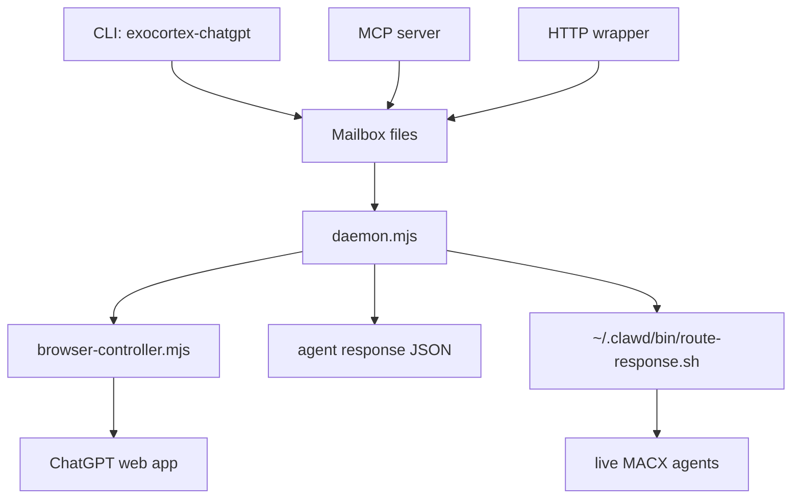

# Architecture

This document explains how `exocortex-chatgpt-connector` works internally. It is written for maintainers who need to debug, extend, or safely change the system.

## Current Runtime Choice

The production runtime is browser automation against `https://chatgpt.com` using Chrome through Patchright.

The native macOS ChatGPT app controller still exists in this repository as experimental code:

- `native-controller.mjs`
- `native/chatgpt-ax-helper.m`
- `scripts/install-daemon-app-wrapper.sh`
- `scripts/build-native-helper.sh`

Do not treat the native path as production unless it is explicitly revalidated. The browser path is the default because it exposes stable DOM state, URL state, independent tabs, and reliable per-request isolation.

## High-Level Shape

There are five layers:

1. Public interfaces
2. Mailbox and persistent state
3. Daemon scheduler
4. Browser controller
5. Notification routing



## Main Files

`cli.mjs`

Command dispatcher. It handles `launch`, `daemon`, `server`, `http`, `status`, `submit`, `fetch`, `query`, `image`, `last`, `new`, `model`, `thinking`, `stop`, and `check`.

Controller commands import `browser-controller.mjs`. The `launch` command imports `launcher.mjs` and keeps a visible or off-screen browser owner alive.

`mcp-server.mjs`

Starts an MCP stdio server and registers tools from `mcp-tools.mjs`.

`mcp-tools.mjs`

Defines the MCP surface:

- `submit_pro`
- `submit_image`
- `query`
- `status`
- `fetch`

Agents should usually use `submit_pro` or `submit_image`, then read/fetch the result later. `query` is blocking and exists mainly for interactive use.

`mailbox.mjs`

Owns durable state:

- request files
- response files
- image output directories
- daemon pid file
- response notification routing

This module is intentionally browser-agnostic. It should not know about selectors, pages, tabs, or AX.

`daemon.mjs`

Owns the async worker loop. It watches request files, claims locks, enforces one active request per agent, starts work in browser tabs, and persists responses.

`daemon-core.mjs`

Processes one claimed request. It creates an ephemeral browser tab, runs the prompt, verifies files, writes the response, closes successful tabs, and keeps error tabs open.

`browser-controller.mjs`

Owns Patchright/Chrome automation. It can attach to an existing CDP endpoint or launch its own persistent browser context. It handles:

- ChatGPT page discovery
- ephemeral tab creation and cleanup
- prompt submission
- model selection
- thinking level selection
- response extraction
- image detection and download
- selector checks

`launcher.mjs`

Starts a long-running Chrome/Patchright owner with a persistent profile and writes the CDP endpoint to disk.

`selectors.json`

Central selector map for ChatGPT DOM automation. Selector changes should happen here unless the control flow itself changes.

`runtime-paths.mjs`

Normalizes runtime paths under `$EXOCORTEX_HOME/chatgpt`. It also falls back to the legacy `~/.chatgpt-mcp/profile` and `~/.chatgpt-mcp/cdp` when the new profile/CDP files do not exist, so the connector can reuse the old logged-in browser session.

## Runtime State

Default runtime home:

```text
~/.exocortex/chatgpt/
```

If `EXOCORTEX_HOME` is set, runtime home is:

```text
$EXOCORTEX_HOME/chatgpt/
```

Important paths:

```text
requests/                         pending and active request JSON files
agents/<agent>/pro/<request>.json persisted responses
agents/<agent>/images/            default image output root
images/                           legacy/general image root
profile/                          Chrome/Patchright profile, if not using legacy fallback
cdp                               browser CDP endpoint
daemon.pid                        daemon pid claim
```

Legacy fallback paths:

```text
~/.chatgpt-mcp/profile/
~/.chatgpt-mcp/cdp
```

## Request Lifecycle

1. A caller runs `submit`, `submit_pro`, or `submit_image`.
2. `mailbox.submit()` writes a JSON file under `requests/`.
3. `ensureDaemonRunning()` starts `cli.mjs daemon` if no live daemon pid exists.
4. `daemon.mjs` lists requests and claims one by creating `<request>.json.lock`.
5. The daemon skips work for an agent that already has an in-flight request.
6. `daemon-core.mjs` marks the request active.
7. `browser-controller.createEphemeralChatPage()` opens a fresh ChatGPT tab.
8. `browser-controller.queryInPage()` runs the prompt.
9. On success:
   - image files are verified if present
   - response JSON is atomically written
   - request JSON is removed
   - successful tab is closed
   - notification routing is attempted
10. On error:
   - error response JSON is written
   - request JSON is removed
   - browser tab is marked as error and left open for inspection
   - notification routing is attempted

## Request JSON

Example text request:

```json
{
  "request_id": "1776972195179-ea5e-codex_parallel_a",
  "state": "pending",
  "prompt": "What is 11 plus 31?",
  "agent": "codex_parallel_a",
  "model": "pro",
  "thinking": "extended",
  "fresh": true,
  "mode": "text",
  "response_path": "/Users/fredluz/.exocortex/chatgpt/agents/codex_parallel_a/pro/1776972195179-ea5e-codex_parallel_a.json",
  "output_dir": null,
  "image_dir": null,
  "created_at": "2026-04-23T19:23:15.179Z",
  "updated_at": "2026-04-23T19:23:15.179Z"
}
```

Important fields:

- `request_id`: stable id, generated from timestamp, random suffix, and normalized agent.
- `agent`: used for response path and one-in-flight-per-agent scheduling.
- `fresh`: defaults to `true`; set `false` only to continue the current conversation.
- `mode`: `text` or `image`.
- `model`: visible model route. Images default to `pro` in this repo.
- `response_path`: durable JSON response path.
- `image_dir`: output directory for image files.

## Response JSON

Example text response:

```json
{
  "request_id": "1776972195179-ea5e-codex_parallel_a",
  "state": "complete",
  "agent": "codex_parallel_a",
  "response_path": "/Users/fredluz/.exocortex/chatgpt/agents/codex_parallel_a/pro/1776972195179-ea5e-codex_parallel_a.json",
  "text": "42",
  "files": [],
  "mode": "text",
  "image_dir": null,
  "created_at": "2026-04-23T19:23:15.179Z",
  "started_at": "2026-04-23T19:23:15.267Z",
  "finished_at": "2026-04-23T19:23:49.453Z",
  "elapsed_ms": 34274
}
```

Example image response:

```json
{
  "request_id": "1776972195337-3002-codex_parallel_img",
  "state": "complete",
  "agent": "codex_parallel_img",
  "text": "",
  "files": [
    "/Users/fredluz/.exocortex/chatgpt/e2e-images/20260423-202315/01.png"
  ],
  "mode": "image",
  "image_dir": "/Users/fredluz/.exocortex/chatgpt/e2e-images/20260423-202315"
}
```

## Parallelism Model

The daemon allows parallel work across agents and serial work within one agent.

This is deliberate:

- A single agent should receive responses in request order.
- Different agents can use independent ChatGPT tabs concurrently.
- Browser tabs give isolation that the native app did not provide.

Implementation details:

- `inFlightByRequest` prevents duplicate work on the same request id.
- `inFlightByAgent` prevents concurrent work for the same normalized agent.
- Each request gets an ephemeral tab tagged with `window.name`.
- Successful tabs close after response persistence.
- Error tabs remain open and are tagged for inspection.

## Browser Ownership

The controller first tries to attach to a CDP endpoint:

1. `CHATGPTPRO_CDP`, if set
2. runtime `cdp` file
3. legacy `~/.chatgpt-mcp/cdp`, if runtime `cdp` does not exist

If attach fails and `CHATGPT_MCP_ATTACH_ONLY=1` is not set, the controller launches its own persistent Chrome context.

Visible launch:

```bash
exocortex-chatgpt launch --visible
```

Off-screen launch:

```bash
exocortex-chatgpt launch
```

Automatic daemon launch is off-screen unless `CHATGPT_VISIBLE=1` is set.

## Model and Thinking Selection

Model and thinking selection are controlled through selectors in `selectors.json`.

Common routes:

- Pro text: model `pro`, thinking `extended`
- Pro image: model `pro`, mode `image`

`submit_pro` hard-routes to:

```json
{
  "model": "pro",
  "thinking": "extended",
  "mode": "text"
}
```

`submit_image` hard-routes to:

```json
{
  "model": "pro",
  "mode": "image",
  "fresh": true
}
```

## Image Handling

Image mode is handled by `generateImageOnPage()` in `browser-controller.mjs`.

The controller:

1. Records currently visible generated image URLs.
2. Sends the prompt.
3. Waits for new image candidates.
4. Supports normal URLs and `blob:` URLs.
5. Downloads authenticated URLs through the browser context request API.
6. Extracts `blob:` URLs through page JavaScript, with a canvas fallback.
7. Writes image files to `image_dir`.
8. Returns file paths in response JSON.
9. `daemon-core.mjs` verifies file existence and PNG magic bytes before closing the tab.

This "disk first, close tab second" order is important. Do not close image tabs before files are verified.

## Notifications to Agents

After a response is persisted, the daemon calls `notifyAgentIfAvailable()`.

Production daemon routing uses:

```text
~/.clawd/bin/route-response.sh
```

The message shape for text:

```text
exocortex-chatgpt response ready: <request_id> at <response_path> - preview: <preview> Original request: <brief>
```

The message shape for images:

```text
exocortex-chatgpt images ready: <request_id> in <image_dir> - <N> file(s). Response at <response_path>. Original request: <brief>
```

Notification failures are intentionally non-fatal. Response JSON remains the source of truth.

## MCP Contract

The MCP server is an adapter over the mailbox. It does not own browser state directly.

Recommended agent flow:

1. Call `submit_pro` or `submit_image`.
2. Store `request_id` and `response_path` or `image_dir`.
3. Continue other work.
4. Wait for routed notification or poll `status`.
5. Call `fetch` or read the response JSON directly.

Avoid `query` for long-running agent work because it blocks the MCP caller until the response is complete.

## Safety Invariants

These invariants should be preserved in changes:

- Do not inject hidden request markers into prompts.
- Fresh conversation is the default for queued work.
- Reusing a current conversation requires explicit `--no-fresh` or `fresh: false`.
- One active request per agent.
- Multiple agents can run in parallel.
- Persist response JSON before closing successful tabs.
- Verify image files before closing image tabs.
- Keep error tabs open.
- Notification delivery must not be required for response persistence.
- Browser profile and CDP endpoint must resolve to the same runtime home.

## Native Path Status

The native path is experimental. It was not deleted so it can be revisited later, but it should not be used by default.

Known native path issues:

- Completion detection via macOS notifications was not reliable enough.
- Conversation switching without visible marker search needs a better source of truth.
- AX reduced some System Events usage but did not eliminate focus and state problems.
- The native app does not provide independent tabs comparable to the browser backend.

If native work resumes, keep it behind an explicit feature flag and re-run the full E2E plan in [E2E Verification](E2E_VERIFICATION.md).
